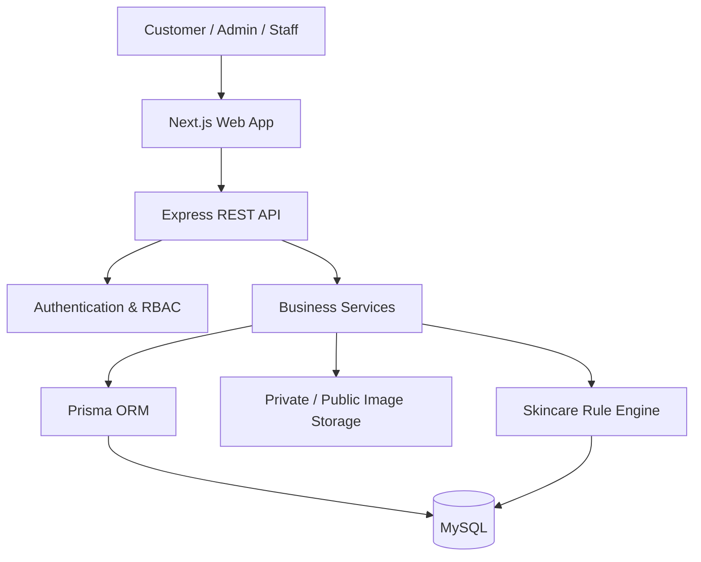

# BuyGuide — Beauty & Skincare E-commerce

<p align="center">
  <strong>Nền tảng thương mại điện tử mỹ phẩm và chăm sóc da</strong><br/>
  Mua sắm sản phẩm làm đẹp · Quản lý bán hàng · Tư vấn chăm sóc da
</p>

<p align="center">
  
  
  
  
  
  
</p>

## 1. Giới thiệu

**BuyGuide** là dự án website thương mại điện tử chuyên kinh doanh mỹ phẩm và sản phẩm chăm sóc da. Dự án tham khảo cách tổ chức và trải nghiệm mua sắm của các nền tảng bán lẻ mỹ phẩm hiện đại như Hasaki, nhưng sử dụng tên thương hiệu, giao diện và nội dung riêng.

Đây là hệ thống full-stack có thể vận hành và mô phỏng nghiệp vụ thực tế, không phải website tĩnh. Hệ thống hướng đến ba nhóm chức năng chính:

- **E-commerce:** danh mục, thương hiệu, sản phẩm, tìm kiếm, giỏ hàng, đặt hàng và thanh toán mô phỏng.
- **Quản trị vận hành:** quản lý sản phẩm, giá nhập/giá bán, nhà cung cấp, phiếu nhập, tồn kho, đơn hàng và báo cáo.
- **Skincare consultation:** tiếp nhận thông tin tình trạng da, hình ảnh riêng tư và đưa ra gợi ý chăm sóc da/sản phẩm dựa trên quy tắc; có thiết kế mở để tích hợp AI sau này.

> **Lưu ý:** BuyGuide là dự án học tập và mô phỏng nghiệp vụ. Tư vấn da chỉ mang tính tham khảo, không thay thế chẩn đoán hoặc điều trị của bác sĩ da liễu.

## 2. Mục tiêu

- Xây dựng website responsive trên máy tính, tablet và điện thoại.
- Có đầy đủ Frontend, Backend API và MySQL Database.
- Quản lý được giá vốn, giá bán, lịch sử giá và biến động kho.
- Mô phỏng luồng mua hàng và quản lý đơn hàng có kiểm soát tồn kho.
- Phân quyền Admin, Nhân viên và Khách hàng.
- Có dữ liệu mẫu, hướng dẫn cài đặt và quy trình kiểm thử.
- Dễ mở rộng, dễ bảo trì và có tài liệu kỹ thuật rõ ràng.

## 3. Công nghệ

| Thành phần | Công nghệ dự kiến | Vai trò |
|---|---|---|
| Frontend | Next.js (React) | Giao diện khách hàng và Admin |
| Styling | Tailwind CSS | Responsive UI và design system |
| Backend | Node.js + Express | REST API, nghiệp vụ và phân quyền |
| Database | MySQL | Lưu dữ liệu hệ thống |
| ORM | Prisma | Schema, migration và truy vấn dữ liệu |
| Authentication | JWT + refresh/session strategy | Đăng nhập và xác thực |
| Image storage | Local storage khi phát triển; adapter để mở rộng object storage | Ảnh sản phẩm và ảnh tư vấn |
| Charts | Thư viện biểu đồ tương thích React | Dashboard và báo cáo |

Kiến trúc được tổ chức theo **monorepo** để frontend, backend, database schema và tài liệu nằm trong cùng repository nhưng vẫn tách biệt trách nhiệm.

## 4. Định hướng giao diện và màu sắc

BuyGuide sử dụng bảng màu thiên nhiên, tối giản và cao cấp theo mẫu màu đã được chủ dự án chọn: Denim Blue `#202C60`, Carolina Blue `#8FACCA`, Beige `#F5F3DC`, Pistachio `#B6CF7B` và Fern Green `#4C7026`. Hồng pastel không còn là màu chủ đạo. Xem [Design System & Brand Colors](docs/design-system.md).

## 5. Phạm vi chức năng

### Khách hàng
- Đăng ký, đăng nhập, cập nhật hồ sơ và địa chỉ.
- Tìm kiếm, lọc, xem sản phẩm và thương hiệu.
- Quản lý giỏ hàng, đặt hàng và chọn phương thức thanh toán mô phỏng.
- Theo dõi đơn hàng, xem lịch sử mua và đánh giá sản phẩm.
- Gửi thông tin tình trạng da, tải ảnh tư vấn, xem kết quả và lịch sử tư vấn.
- Thêm sản phẩm được đề xuất vào giỏ hàng.

### Admin và nhân viên
- Dashboard doanh thu, đơn hàng, khách hàng, tồn kho và cảnh báo hàng sắp hết.
- Quản lý sản phẩm, danh mục, thương hiệu, hình ảnh và chương trình khuyến mãi.
- Cập nhật giá nhập, giá bán, giá khuyến mãi và theo dõi lịch sử giá.
- Quản lý nhà cung cấp, lập phiếu nhập và cập nhật tồn kho.
- Quản lý đơn hàng, xác nhận, cập nhật trạng thái và hủy đơn.
- Quản lý khách hàng và phân quyền theo vai trò.

## 6. Kiến trúc hệ thống



**Nguyên tắc phân chia trách nhiệm:**
- Next.js chỉ phụ trách giao diện, trải nghiệm người dùng và gọi API.
- Express xử lý xác thực, phân quyền, kiểm tra dữ liệu và nghiệp vụ.
- Prisma là lớp truy cập dữ liệu; MySQL là nguồn dữ liệu chính.
- Quy tắc giá, tồn kho, đơn hàng và lợi nhuận phải được xử lý ở Backend.
- Các thao tác nhiều bước liên quan đến tiền và tồn kho phải dùng transaction database.
- Ảnh tư vấn da phải được lưu riêng tư, kiểm soát quyền truy cập và hỗ trợ xóa.

## 7. Tiến độ dự án

| Giai đoạn | Nội dung | Trạng thái |
|---|---|---|
| 1 | Phân tích yêu cầu, kiến trúc, ERD và thiết kế dữ liệu | In progress |
| 2 | MySQL/Prisma, Backend API và dữ liệu mẫu | Planned |
| 3 | Frontend, trang chủ và trang sản phẩm | Planned |
| 4 | Quản lý sản phẩm, nhập hàng và tồn kho | Planned |
| 5 | Giỏ hàng, đặt hàng và quản lý đơn hàng | Planned |
| 6 | Tư vấn da và gợi ý sản phẩm | Planned |
| 7 | Admin Dashboard, thống kê và báo cáo | Planned |
| 8 | Kiểm thử, sửa lỗi và tài liệu sử dụng | Planned |

Mỗi giai đoạn cần có đầu ra, tiêu chí nghiệm thu và kiểm thử trước khi chuyển sang giai đoạn tiếp theo.

## 8. Tài liệu

- [Kiến trúc hệ thống, ERD và mô tả Database](docs/architecture.md)
- [Design System & Brand Colors](docs/design-system.md)

## 9. Quy tắc nghiệp vụ quan trọng

1. Mật khẩu chỉ lưu dưới dạng hash; không lưu mật khẩu thuần.
2. Giá tiền dùng kiểu `DECIMAL`, không dùng số thực dấu phẩy động.
3. Đơn hàng lưu snapshot tên sản phẩm, SKU, giá bán và giá vốn tại thời điểm chốt đơn.
4. Tồn kho không được âm; cập nhật kho phải có transaction và kiểm tra số lượng.
5. Phiếu nhập được xác nhận mới làm tăng tồn kho.
6. Đơn hàng chỉ trừ kho tại thời điểm chuyển sang trạng thái được xác nhận theo quy trình đã thống nhất; hủy đơn chỉ hoàn kho nếu trước đó đơn đã trừ kho.
7. Mọi biến động kho phải ghi vào `inventory_transactions`.
8. Lịch sử giá phải được lưu, không ghi đè làm mất dữ liệu cũ.
9. Ảnh tư vấn da không được công khai bằng URL không bảo vệ; chỉ chủ sở hữu và nhân sự có quyền mới được truy cập theo chính sách.
10. Tư vấn da không đưa ra chẩn đoán bệnh.

## 10. Cấu trúc repository dự kiến

```text
BuyGuide_App/
├── apps/
│   ├── web/                 # Next.js customer website & admin UI
│   └── api/                 # Express REST API
├── packages/
│   └── shared/              # Shared types, constants and validators
├── prisma/
│   ├── schema.prisma
│   ├── migrations/
│   └── seed/
├── docs/
│   ├── architecture.md
│   ├── api-specification.md
│   └── testing-plan.md
├── storage/
│   └── .gitkeep             # Local uploads (ignored by Git)
├── .env.example
├── .gitignore
└── README.md
```

Cấu trúc trên là cấu trúc mục tiêu; các thư mục và mã nguồn sẽ được tạo ở những giai đoạn tương ứng.

## 11. Trạng thái hiện tại

Repository đang ở giai đoạn khởi tạo tài liệu và thiết kế. Chưa có chức năng bán hàng hoặc API nào được xem là hoàn thành cho đến khi được triển khai và kiểm thử.

## 12. Định hướng đóng góp và phát triển

- Làm việc theo từng giai đoạn, không bỏ qua kiểm thử.
- Đặt tên biến, hàm, API và database nhất quán.
- Không commit file `.env`, mật khẩu, token hoặc ảnh tư vấn riêng tư.
- Mỗi thay đổi nghiệp vụ cần cập nhật tài liệu và kiểm thử liên quan.
- Ưu tiên code dễ đọc, module hóa và có thể bảo trì.

---

<p align="center">
  <strong>BuyGuide</strong> · Beauty shopping made clearer.
</p>
