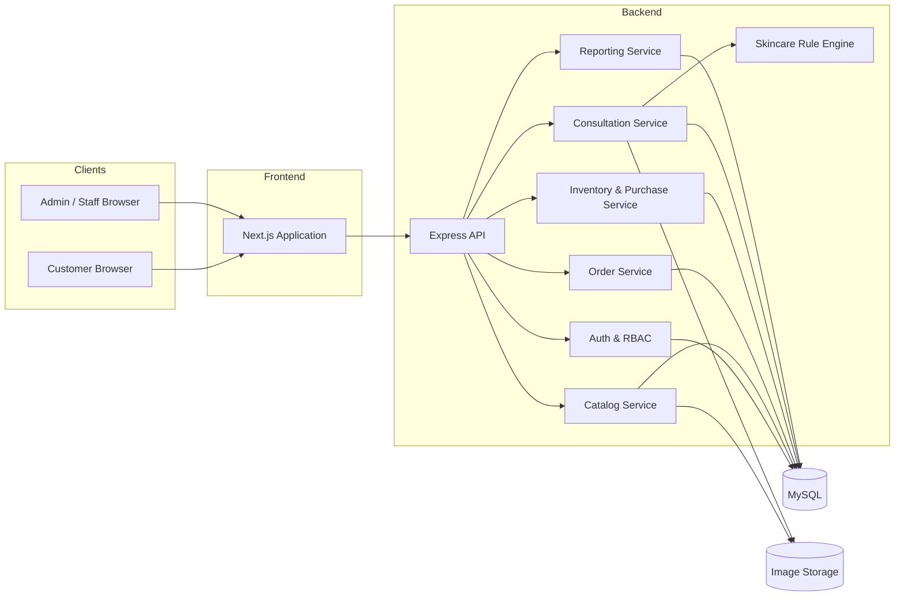
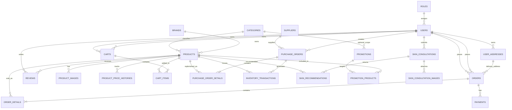

# BuyGuide — System Architecture & Database Design

> **Phase 1 — Analysis and Design**  
> Tài liệu này xác định kiến trúc, mô hình dữ liệu, quan hệ giữa các bảng và quy tắc nghiệp vụ trước khi triển khai code.

## 1. Phạm vi thiết kế

Hệ thống gồm các miền nghiệp vụ:

1. Identity & Access — tài khoản, vai trò, địa chỉ.
2. Catalog — danh mục, thương hiệu, sản phẩm, hình ảnh, khuyến mãi.
3. Pricing — giá nhập, giá bán, giá khuyến mãi và lịch sử giá.
4. Procurement & Inventory — nhà cung cấp, phiếu nhập, chi tiết nhập và biến động kho.
5. Commerce — giỏ hàng, đơn hàng, chi tiết đơn, thanh toán, đánh giá.
6. Skincare Consultation — hồ sơ tư vấn, ảnh riêng tư và đề xuất sản phẩm.

## 2. Kiến trúc đề xuất

### 2.1. Lựa chọn công nghệ

| Lớp | Công nghệ | Lý do |
|---|---|---|
| Web | Next.js + React | Routing, SEO cho trang sản phẩm, component-based UI |
| UI | Tailwind CSS | Responsive, dễ chuẩn hóa giao diện |
| API | Node.js + Express | REST API rõ ràng, phù hợp tách frontend/backend |
| ORM | Prisma | Schema/migration có kiểm soát, type-safe |
| Database | MySQL 8.x | Quan hệ dữ liệu và transaction |
| Auth | JWT access token + refresh token rotation hoặc secure session | Phân quyền và quản lý phiên |
| Validation | Zod hoặc thư viện schema tương đương | Kiểm tra dữ liệu đầu vào |
| Upload | Storage adapter | Tách nghiệp vụ khỏi nơi lưu file |

### 2.2. Sơ đồ kiến trúc

### 2.3. Nguyên tắc thiết kế

- Frontend không truy cập MySQL trực tiếp.
- Backend là nơi duy nhất quyết định giá cuối cùng, tồn kho, quyền truy cập và trạng thái đơn.
- Các thao tác tạo đơn, xác nhận đơn, hủy đơn, nhập kho phải chạy trong database transaction.
- Tách controller, service, repository/data access, middleware và validation.
- Lưu file qua storage adapter; database chỉ lưu metadata và storage key/path.
- Dùng soft delete hoặc trạng thái ngừng kinh doanh cho dữ liệu cần giữ lịch sử như sản phẩm, thương hiệu, danh mục.
- Log các hành động quản trị quan trọng; có thể bổ sung audit_logs ở giai đoạn triển khai nếu phạm vi cần truy vết chi tiết.

## 3. ERD — mô hình quan hệ

Sơ đồ dưới đây thể hiện các quan hệ chính. Để dễ đọc, các trường không phải khóa và các quan hệ phụ đã được lược bớt; danh sách bảng và ý nghĩa đầy đủ nằm ở phần 4.

**Ghi chú:** `PROMOTION_PRODUCTS` là bảng liên kết bổ sung để hỗ trợ một chương trình áp dụng cho nhiều sản phẩm và một sản phẩm tham gia nhiều chương trình. Không nên nhét nhiều product_id vào một cột của `promotions`.

## 4. Giải thích các bảng dữ liệu

### 4.1. Người dùng và phân quyền

| Bảng | Chức năng | Trường/quan hệ quan trọng |
|---|---|---|
| `roles` | Danh sách vai trò | `id`, `name` (ADMIN, STAFF, CUSTOMER), `description` |
| `users` | Tài khoản người dùng | `role_id` FK, `email` UNIQUE, `password_hash`, `full_name`, `phone`, `status` |
| `user_addresses` | Địa chỉ giao hàng | `user_id` FK, người nhận, số điện thoại, địa chỉ, `is_default` |

Một người dùng thuộc một vai trò trong phiên bản đầu. Nếu sau này một người có thể có nhiều vai trò, chuyển sang mô hình many-to-many bằng bảng `user_roles`.

### 4.2. Danh mục và sản phẩm

| Bảng | Chức năng | Trường/quan hệ quan trọng |
|---|---|---|
| `categories` | Danh mục phân cấp | `parent_id` tự tham chiếu, `name`, `slug` UNIQUE |
| `brands` | Thương hiệu | `name`, `slug` UNIQUE, `logo_path`, `status` |
| `products` | Thông tin sản phẩm | `category_id`, `brand_id`, `sku` UNIQUE, tên, mô tả, thành phần, công dụng, loại da, giá hiện tại, tồn kho |
| `product_images` | Ảnh sản phẩm | `product_id` FK, `storage_key`, `alt_text`, `is_primary`, `sort_order` |
| `product_price_histories` | Lịch sử thay đổi giá | `product_id` FK, loại giá, giá cũ/mới, thời điểm hiệu lực, người cập nhật |
| `promotions` | Chương trình khuyến mãi | mã, tên, loại giảm, giá trị giảm, thời gian, trạng thái |
| `promotion_products` | Sản phẩm thuộc chương trình | cặp `promotion_id` + `product_id` UNIQUE, tùy chọn giá/giảm riêng |

**Thiết kế giá:** `products` giữ giá hiện hành để truy vấn nhanh. `product_price_histories` lưu các lần thay đổi giá nhập, giá bán và giá khuyến mãi. Mọi giá tiền dùng DECIMAL (ví dụ DECIMAL(12,2)); không dùng FLOAT/DOUBLE.

**Tồn kho:** `products.stock_quantity` là số lượng hiện tại để đọc nhanh; sổ biến động chuẩn là `inventory_transactions`. Hai phần phải được cập nhật cùng transaction.

### 4.3. Nhà cung cấp và nhập hàng

| Bảng | Chức năng | Trường/quan hệ quan trọng |
|---|---|---|
| `suppliers` | Nhà cung cấp | tên, mã, liên hệ, địa chỉ, trạng thái |
| `purchase_orders` | Phiếu nhập hàng | mã phiếu, `supplier_id`, `created_by`, trạng thái, tổng tiền, ngày nhập |
| `purchase_order_details` | Chi tiết phiếu nhập | `purchase_order_id`, `product_id`, số lượng, `unit_cost` snapshot, thành tiền |
| `inventory_transactions` | Sổ biến động kho | `product_id`, loại giao dịch, số lượng +/- , tồn trước/sau, tham chiếu phiếu nhập/đơn hàng, người thao tác |

Phiếu nhập ở trạng thái nháp không làm tăng kho. Khi xác nhận phiếu nhập, backend kiểm tra dữ liệu và tăng tồn kho, đồng thời ghi transaction vào `inventory_transactions`. Không sửa trực tiếp lịch sử giao dịch đã xác nhận; điều chỉnh sai lệch bằng giao dịch điều chỉnh mới.

### 4.4. Giỏ hàng, đơn hàng và thanh toán

| Bảng | Chức năng | Trường/quan hệ quan trọng |
|---|---|---|
| `carts` | Giỏ hàng của người dùng | `user_id`, trạng thái, thời gian cập nhật |
| `cart_items` | Sản phẩm trong giỏ | `cart_id`, `product_id`, số lượng; UNIQUE(cart_id, product_id) |
| `orders` | Đơn hàng | mã đơn, `user_id`, địa chỉ giao snapshot, trạng thái, tổng tiền, phí vận chuyển, giảm giá |
| `order_details` | Chi tiết đơn | sản phẩm, SKU/tên snapshot, số lượng, giá bán snapshot, giá vốn snapshot, thành tiền |
| `payments` | Giao dịch thanh toán | `order_id`, phương thức, số tiền, trạng thái, mã tham chiếu mô phỏng |
| `reviews` | Đánh giá sản phẩm | `user_id`, `product_id`, số sao, nội dung, trạng thái duyệt |

**Snapshot đơn hàng:** Khi tạo đơn, sao chép tên sản phẩm, SKU, giá bán và giá vốn tại thời điểm chốt đơn vào `order_details`. Nhờ đó đơn cũ không thay đổi khi quản trị viên cập nhật sản phẩm.

**Địa chỉ giao hàng:** lưu snapshot người nhận/địa chỉ trên `orders` để việc người dùng sửa hoặc xóa địa chỉ sau này không làm thay đổi đơn hàng đã đặt.

### 4.5. Tư vấn chăm sóc da

| Bảng | Chức năng | Trường/quan hệ quan trọng |
|---|---|---|
| `skin_consultations` | Hồ sơ một lần tư vấn | `user_id`, loại da, vấn đề da, mô tả, trạng thái xử lý, phiên bản rule engine, nội dung kết quả |
| `skin_consultation_images` | Ảnh đính kèm riêng tư | `consultation_id`, storage key, MIME type, kích thước, thời điểm xóa |
| `skin_recommendations` | Sản phẩm được đề xuất | `consultation_id`, `product_id`, lý do, điểm phù hợp, thứ tự |

Ảnh tư vấn không lưu trực tiếp dưới dạng public URL. API tải ảnh phải xác thực quyền sở hữu hoặc quyền nhân viên được cấp. Hỗ trợ xóa ảnh và metadata theo yêu cầu người dùng/chính sách lưu trữ. Không dùng ảnh để huấn luyện AI nếu chưa có cơ chế xin phép riêng.

**Rule engine phiên bản đầu:** dựa trên loại da, vấn đề da và thuộc tính sản phẩm (loại da phù hợp, công dụng, thành phần). Kết quả phải giải thích được vì sao gợi ý. Không suy luận bệnh lý hoặc đưa ra chẩn đoán.

## 5. Quy tắc nghiệp vụ chi tiết

### 5.1. Nhập hàng

1. Nhân viên tạo phiếu nhập ở trạng thái DRAFT.
2. Thêm các dòng sản phẩm, số lượng và đơn giá nhập.
3. Backend tính thành tiền từng dòng và tổng phiếu; không tin tổng tiền do frontend gửi lên.
4. Khi xác nhận: mở transaction, khóa/kiểm tra bản ghi kho phù hợp, đổi trạng thái phiếu, tăng `products.stock_quantity`, ghi `inventory_transactions`.
5. Chặn xác nhận lặp để không cộng kho hai lần.

Công thức: `line_total = quantity × unit_cost`; `purchase_total = SUM(line_total)`.

### 5.2. Đặt hàng và tồn kho

Đề xuất quy trình đơn giản, phù hợp mô phỏng:

- Khi khách tạo đơn: lưu đơn ở trạng thái `PENDING`, chưa trừ tồn kho.
- Khi Admin xác nhận: trong một transaction, kiểm tra tồn kho từng sản phẩm, trừ kho, ghi giao dịch `SALE_OUT`, chuyển đơn sang `CONFIRMED`.
- Nếu không đủ hàng, rollback toàn bộ và trả lỗi rõ ràng.
- Nếu đơn đã trừ kho rồi mới bị hủy: chỉ hoàn kho một lần, ghi `CANCEL_RETURN`, chuyển trạng thái `CANCELLED`.
- Nếu đơn bị hủy khi chưa xác nhận: không phát sinh hoàn kho.
- Chặn chuyển trạng thái không hợp lệ và chống thao tác lặp bằng kiểm tra trạng thái/idempotency.

Nếu về sau cần giữ hàng ngay khi khách đặt, bổ sung cơ chế reservation và thời hạn giữ hàng thay vì thay đổi ngầm quy tắc hiện tại.

### 5.3. Giá vốn và lợi nhuận

- Lịch sử giá nhập ghi nhận giá mua theo từng lần cập nhật/nhập.
- `order_details.unit_cost_snapshot` giữ giá vốn dùng để tính lợi nhuận của đơn tại thời điểm bán.
- Doanh thu thuần = tổng tiền hàng hợp lệ sau giảm giá, không bao gồm đơn hủy/hoàn.
- Giá vốn hàng bán = tổng `quantity × unit_cost_snapshot` của hàng đã bán hợp lệ.
- Lợi nhuận gộp = doanh thu thuần − giá vốn hàng bán.

Đối với hàng cùng SKU nhập ở nhiều mức giá, cần thống nhất phương pháp tính giá vốn trước khi làm báo cáo. Khuyến nghị **bình quân gia quyền liên tục** cho phiên bản đầu; khi xuất kho, chụp đơn giá vốn bình quân vào `order_details`. Nếu yêu cầu quản lý theo lô, mở rộng thêm inventory lots/stock layers ở giai đoạn sau.

### 5.4. Thanh toán mô phỏng

- Hỗ trợ COD và thanh toán mô phỏng (ví dụ chuyển khoản giả lập).
- Không thu thập thông tin thẻ ngân hàng thật.
- Mỗi lần thử thanh toán lưu một bản ghi `payments`; trạng thái đơn và thanh toán là hai trạng thái riêng.
- Chỉ ghi nhận thanh toán thành công khi backend xác nhận kết quả mô phỏng hợp lệ.

### 5.5. Bảo mật và quyền riêng tư

- Hash mật khẩu bằng Argon2id hoặc bcrypt với cấu hình an toàn.
- Phân quyền RBAC tại backend; ẩn nút trên frontend không thay thế kiểm tra quyền API.
- Validate dữ liệu, giới hạn request, chống brute force cho đăng nhập.
- Upload kiểm tra MIME thực tế, dung lượng, phần mở rộng và tên file; không tin tên file do client gửi.
- Ảnh tư vấn nằm trong private storage; dùng API có xác thực hoặc signed URL thời hạn ngắn.
- Không commit ảnh người dùng, secrets, token hoặc file `.env` lên Git.
- Có chính sách xóa ảnh và dữ liệu tư vấn; lưu ý backup có thể có chu kỳ xóa riêng.

## 6. Index, unique và constraint đề xuất

| Bảng | Ràng buộc / Index |
|---|---|
| users | UNIQUE(email), INDEX(phone), INDEX(role_id, status) |
| roles | UNIQUE(name) |
| user_addresses | INDEX(user_id), FK user_id |
| categories | UNIQUE(slug), INDEX(parent_id, status) |
| brands | UNIQUE(slug), INDEX(status) |
| products | UNIQUE(sku), UNIQUE(slug), INDEX(category_id, status), INDEX(brand_id, status), INDEX(price), INDEX(stock_quantity) |
| product_images | INDEX(product_id, sort_order) |
| product_price_histories | INDEX(product_id, price_type, effective_at) |
| suppliers | INDEX(name), UNIQUE(code) nếu dùng mã nhà cung cấp |
| purchase_orders | UNIQUE(code), INDEX(supplier_id, status, created_at) |
| purchase_order_details | INDEX(purchase_order_id), INDEX(product_id) |
| inventory_transactions | INDEX(product_id, created_at), INDEX(reference_type, reference_id) |
| carts | INDEX(user_id, status) |
| cart_items | UNIQUE(cart_id, product_id) |
| orders | UNIQUE(order_code), INDEX(user_id, created_at), INDEX(status, created_at) |
| order_details | INDEX(order_id), INDEX(product_id) |
| payments | INDEX(order_id, status), UNIQUE(transaction_reference) khi reference có giá trị |
| reviews | INDEX(product_id, status), INDEX(user_id) |
| skin_consultations | INDEX(user_id, created_at), INDEX(status) |
| skin_consultation_images | INDEX(consultation_id) |
| skin_recommendations | INDEX(consultation_id, rank), INDEX(product_id) |
| promotions | INDEX(status, starts_at, ends_at), UNIQUE(code) nếu có mã |
| promotion_products | UNIQUE(promotion_id, product_id), INDEX(product_id) |

Dùng foreign key với hành vi xóa phù hợp. Dữ liệu giao dịch (đơn hàng, phiếu nhập, payment, inventory transaction) không nên bị cascade delete. Ưu tiên trạng thái/soft delete cho dữ liệu danh mục và sản phẩm đã phát sinh giao dịch.

## 7. Quy ước trạng thái gợi ý

| Đối tượng | Trạng thái |
|---|---|
| User | ACTIVE, INACTIVE, LOCKED |
| Product | ACTIVE, INACTIVE, OUT_OF_STOCK |
| Purchase order | DRAFT, CONFIRMED, CANCELLED |
| Order | PENDING, CONFIRMED, PROCESSING, SHIPPING, DELIVERED, CANCELLED |
| Payment | PENDING, SUCCESS, FAILED, REFUNDED |
| Consultation | SUBMITTED, PROCESSING, COMPLETED, DELETED |
| Promotion | SCHEDULED, ACTIVE, EXPIRED, DISABLED |

Cần định nghĩa rõ state transition trong service, không cho phép client tự gửi trạng thái bất kỳ.

## 8. Các điểm cần thống nhất trước khi triển khai Database

Đây là các quyết định nghiệp vụ được đề xuất cho phiên bản đầu:

1. **Tài khoản:** một user có một role; Admin có thể tạo/đổi role cho nhân viên.
2. **Tồn kho:** chỉ trừ khi Admin xác nhận đơn; hủy đơn đã xác nhận thì hoàn kho một lần.
3. **Giá vốn:** dùng bình quân gia quyền liên tục; snapshot giá vốn tại thời điểm xác nhận bán.
4. **Khuyến mãi:** hỗ trợ phần trăm hoặc số tiền cố định, có thời hạn và liên kết nhiều sản phẩm.
5. **Thanh toán:** COD và thanh toán giả lập, không tích hợp cổng tiền thật trong bản đầu.
6. **Ảnh:** placeholder cho sản phẩm; ảnh tư vấn lưu private.
7. **Tư vấn:** rule-based ở bản đầu, có version để thay đổi quy tắc mà vẫn truy vết được kết quả cũ.

## 9. Tiêu chí nghiệm thu Giai đoạn 1

- [x] Chọn kiến trúc frontend/backend/database.
- [x] Phân chia các miền nghiệp vụ.
- [x] Mô hình hóa 22 bảng yêu cầu và bảng liên kết khuyến mãi bổ sung.
- [x] Xác định khóa chính/khóa ngoại và các index chính.
- [x] Xác định snapshot giá bán, giá vốn và địa chỉ trên đơn.
- [x] Xác định quy trình nhập hàng, trừ/hoàn kho và transaction.
- [x] Xác định cách lưu ảnh tư vấn riêng tư và giới hạn tư vấn da.
- [ ] Người dùng xác nhận các quyết định nghiệp vụ ở mục 8.
- [ ] Chuyển thiết kế sang Prisma schema/MySQL migration ở Giai đoạn 2.

**Chưa triển khai code hoặc tạo database trong Giai đoạn 1.** Việc triển khai chỉ bắt đầu sau khi thiết kế được duyệt.
